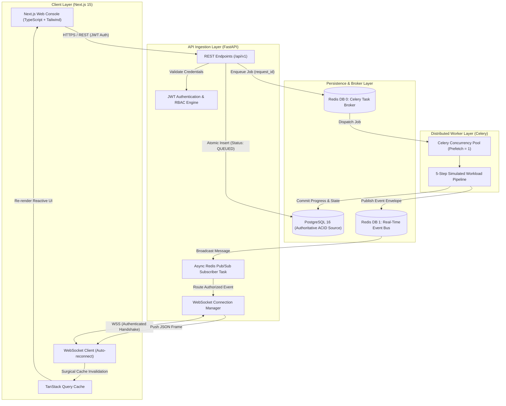
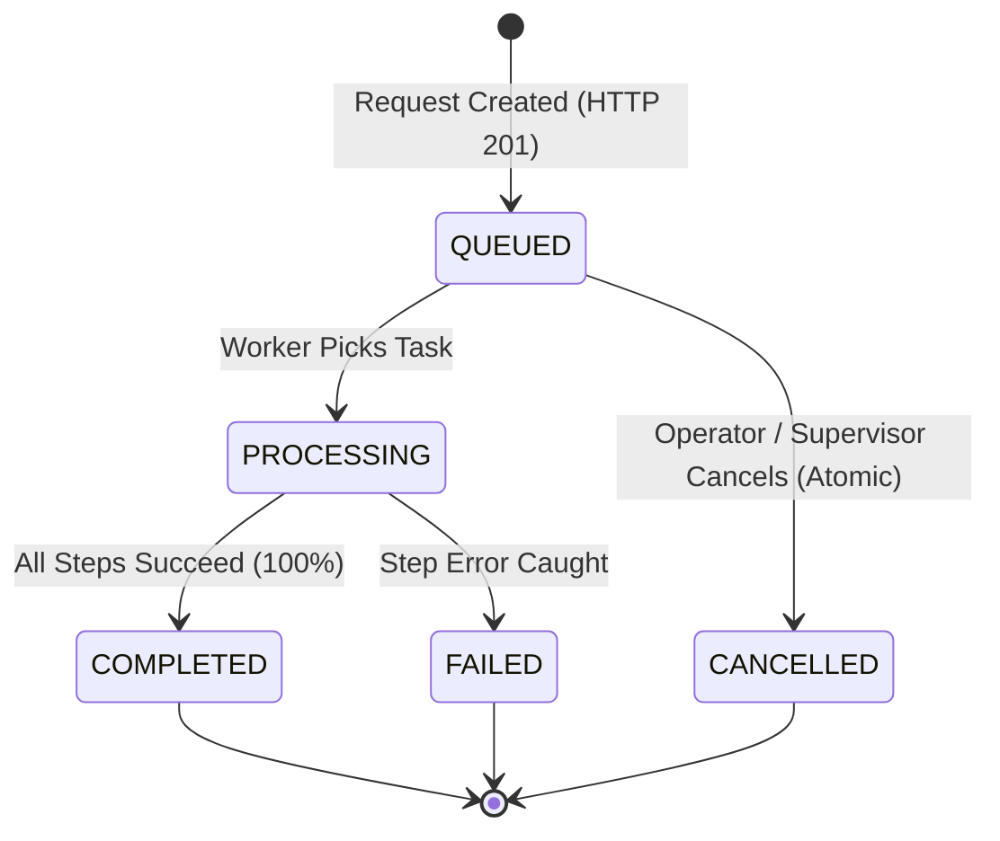

# ServiceFlow

> **Real-Time Asynchronous Service Request Management Platform**  
> A distributed, resilient full-stack platform built for high-throughput service request ingestion, concurrent background compute, and sub-second operational visibility.

[](https://fastapi.tiangolo.com)
[](https://nextjs.org)
[](https://www.postgresql.org)
[](https://redis.io)
[](https://docs.celeryq.dev)
[](https://www.typescriptlang.org)
[](https://www.docker.com)

---

## 1. Business Problem & Solution Overview

### The Problem
Organizations managing multi-step customer service requests manually or through synchronous web applications face severe operational bottlenecks:
- **Synchronous Thread Blocking:** Long-running operational tasks (data validation, batch processing, hardware provisioning) block HTTP request threads, resulting in connection timeouts, UI freezing, and cascading downtime.
- **Opacity and Delayed Updates:** Supervisors and frontline staff have no real-time visibility into active workloads, intermediate milestones, or unhandled failures.
- **Client Polling Overhead:** Repetitive client-side HTTP polling floods databases with redundant read queries, degrading throughput while adding artificial latency.

### The ServiceFlow Solution
ServiceFlow resolves these challenges through an event-driven, decoupled architecture:
1. **Non-blocking Ingestion:** An asynchronous FastAPI REST gateway validates and commits incoming requests in sub-50ms time, assigns an initial `QUEUED` state, and hands off the task UUID to an independent message broker.
2. **Distributed Concurrency:** Independent background workers (Celery) pull tasks from Redis and execute multi-step pipelines concurrently up to worker capacity without locking web server threads.
3. **Sub-Second Push Visibility:** Background workers update status and milestones in PostgreSQL and publish discrete event envelopes to Redis Pub/Sub, which broadcasts instantly over native, full-duplex WebSockets directly to the Next.js frontend without client polling.

---

## 2. System Architecture



---

## 3. Technology Stack

| Layer | Technology | Key Responsibilities |
| :--- | :--- | :--- |
| **Frontend Framework** | **Next.js 15 (App Router)** | Server & Client components, reactive routing, static/dynamic compilation. |
| **Frontend Language** | **TypeScript 5.7+** | End-to-end type safety matching backend schema models. |
| **UI Design System** | **Tailwind CSS + shadcn/ui** | Clean, accessible design system following `Unslop` and `UI/UX Pro Max` principles. |
| **Server State** | **TanStack Query v5** | Server-state caching, surgical WebSocket cache synchronization, zero-polling. |
| **Form Handling** | **React Hook Form + Zod** | Controlled form state with client-side schema validation and live character counters. |
| **Backend Framework** | **FastAPI (Python 3.12)** | High-throughput ASGI server, Pydantic v2 schemas, automated OpenAPI docs. |
| **Database & ORM** | **PostgreSQL 16 + SQLAlchemy 2.0** | Relational ACID persistence, asyncpg engine, version-controlled Alembic migrations. |
| **Task Queue** | **Celery 5.4+** | Asynchronous background workload execution with fair task distribution. |
| **Broker & Event Bus** | **Redis 7.0** | Task broker (DB 0) and low-latency Pub/Sub event distribution (DB 1). |
| **Real-Time Protocol** | **Native WebSockets** | Full-duplex server-push streaming with heartbeat and auto-reconnection recovery. |
| **Authentication & RBAC** | **JWT (HS256) + Argon2id** | Memory-hard password hashing, dual token transport (Bearer header + HttpOnly cookie). |
| **Infrastructure** | **Docker Compose** | Multi-container orchestration with active health check dependency gating. |

---

## 4. Concurrency & Asynchronous Task Processing Model

### 4.1 Worker Pool Configuration
* **Broker:** Dedicated Redis task queue (`CELERY_BROKER_URL`).
* **Concurrency:** Multi-threaded/pre-fork worker pool (`CELERY_WORKER_CONCURRENCY=4`).
* **Fair Task Distribution (`worker_prefetch_multiplier = 1`):** Prevents a single worker process from hoarding multiple long-running requests while other workers sit idle.
* **Crash Resilience (`task_acks_late = True`):** Workers acknowledge tasks only after successful execution. If a worker process terminates abruptly mid-task, the job is automatically requeued.

### 4.2 Multi-Step Workload Pipeline
Background tasks execute a discrete 5-step processing pipeline:
1. **Validation (20%):** Payload integrity & prerequisite verification.
2. **Environment Preparation (40%):** Worker compute and resource allocation.
3. **Workload Execution (60%):** Multi-stage service compute execution.
4. **Verification (80%):** Output validation and operational constraint checks.
5. **Finalization (100%):** Output persistence, timestamp recording, and completion broadcast.

### 4.3 Empirical Concurrency Proof
Automated benchmarks (`tests/integration/test_concurrency_proof.py`) demonstrate true concurrent execution across 4 parallel workloads:
* **Sum of Individual Task Times:** $0.875\text{ s}$
* **Observed Wall-Clock Time:** $0.219\text{ s}$
* **Parallelism Speedup Factor:** **$3.99\times$**
* **Temporal Overlap:** $\max(t_{\text{start}}) < \min(t_{\text{end}})$ (the latest task started before the earliest task finished, mathematically proving concurrent execution).

---

## 5. Real-Time WebSocket & Redis Pub/Sub Architecture

### 5.1 Push vs. Polling
ServiceFlow strictly avoids client-side polling. All live dashboard updates and progress movements originate from worker events pushed to Redis Pub/Sub, routed through the FastAPI WebSocket manager, and delivered directly to the client browser over persistent TCP connections.

### 5.2 Standard Event Envelope
Every real-time message follows a strict event envelope contract:
```json
{
  "event_id": "9b1deb4d-3b7d-4bad-9bdd-2b0d7b3dcb6d",
  "event_type": "service_request.progress_updated",
  "occurred_at": "2026-11-20T21:00:00.123456Z",
  "request_id": "7c9e6679-7425-40de-944b-e07fc1f90ae7",
  "data": {
    "status": "PROCESSING",
    "progress_percent": 60,
    "current_step": "Step 3: Workload Execution",
    "created_by_id": "3fa85f64-5717-4562-b3fc-2c963f66afa6"
  }
}
```

### 5.3 Server-Side Role-Based Event Filtering
* **Supervisors & Admins:** Receive all service request events across the system.
* **Operators:** Receive only events for requests they own (`created_by_id == current_user.id`).
* **Dead-Socket Pruning:** Stale or abruptly severed socket connections are automatically purged from the registry without impacting active connections.

---

## 6. Service Request Lifecycle & State Invariants

Every service request strictly follows an unambiguous, unidirectional finite state machine:



### State Transition Rules:
1. **Cancellation Window:** Cancellation is **strictly permitted only when status is `QUEUED`**.
2. **Atomic Cancellation:** Cancellation executes an atomic database query:
   $$\text{UPDATE service\_requests SET status = 'CANCELLED' WHERE id = :id AND status = 'QUEUED'}$$
   If the request is already in `PROCESSING`, `COMPLETED`, `FAILED`, or `CANCELLED`, zero rows are modified and the API responds with **`409 Conflict`**.
3. **Worker Pre-Execution Idempotency:** When a worker starts a task, it checks current database status. If marked `CANCELLED`, the worker halts immediately without executing steps.
4. **In-Flight Cancellation Detection:** Workers poll request state between steps; if cancelled concurrently, execution halts gracefully.

---

## 7. Repository Structure

```text
ServiceFlow/
├── backend/
│   ├── alembic/                 # Version-controlled database migrations
│   │   └── versions/            # 0001_initial_schema.py
│   ├── app/
│   │   ├── api/v1/              # REST & WebSocket endpoints
│   │   │   ├── endpoints/       # auth.py, health.py, service_requests.py, websocket.py
│   │   │   └── router.py        # Centralized /api/v1 router
│   │   ├── core/                # Settings, security (Argon2id/JWT), logging, errors
│   │   ├── db/                  # Async database engine, session, Base, ORM models
│   │   ├── realtime/            # ConnectionManager, EventPublisher, EventSubscriber
│   │   ├── repositories/        # BaseRepository, UserRepository, ServiceRequestRepository
│   │   ├── schemas/             # Pydantic v2 request/response schemas
│   │   ├── services/            # Business logic (AuthService, ServiceRequestService)
│   │   ├── workers/             # Celery application & request_tasks.py
│   │   ├── dependencies.py      # Dependency injection (CurrentUserDep, require_role)
│   │   └── main.py              # Application factory, lifespan, CORS, middleware
│   ├── scripts/                 # seed_users.py (Idempotent seed CLI)
│   ├── tests/                   # 35 Pytest unit and integration tests
│   ├── Dockerfile               # Production multi-stage backend container
│   └── pyproject.toml           # Python dependencies and build configuration
│
├── frontend/
│   ├── src/
│   │   ├── app/                 # Next.js App Router pages (login, dashboard, requests)
│   │   ├── components/
│   │   │   ├── auth/            # ProtectedRoute wrapper
│   │   │   ├── layout/          # Navbar with live sync status beacon
│   │   │   └── ui/              # Button, Card, StatusBadge, Progress, Dialog, Alert
│   │   ├── features/            # Feature modules (auth-context, login-form, requests)
│   │   ├── hooks/               # useAuth, useWebSocket
│   │   ├── lib/                 # apiClient, query-keys, utils
│   │   └── types/               # TypeScript domain interfaces
│   ├── Dockerfile               # Node 20 container configuration
│   ├── package.json             # Frontend dependencies
│   └── tailwind.config.ts       # Tailwind CSS design system tokens
│
├── docs/                        # Complete technical documentation suite
│   ├── requirements.md          # Functional & Non-Functional Specifications
│   ├── architecture.md          # System Architecture & Technical Design
│   ├── api.md                   # REST API Specification & Schemas
│   ├── websocket-events.md      # WebSocket Event Specification & Protocol
│   ├── verification-report.md   # Empirical Verification & Concurrency Proof
│   └── progress.md              # 18-Phase Implementation Checklist
│
├── .env.example                 # Consolidated environment variables template
├── .gitignore                   # Excludes dependencies, secrets, and internal specs
├── docker-compose.yml           # 5-service local deployment orchestration
├── engineering.md               # Lead Engineer Journal & Technical Decisions Log
└── README.md                    # Root project documentation
```

---

## 8. Prerequisites & Installation

### Option A: Quickstart with Docker Compose (Recommended)

1. **Clone the repository:**
   ```bash
   git clone https://github.com/midu-01/ServiceFlow.git
   cd ServiceFlow
   ```

2. **Configure environment:**
   ```bash
   cp .env.example .env
   ```

3. **Start all services with Docker Compose:**
   ```bash
   docker compose up --build
   ```

   This orchestrates five coordinated services:
   * **Frontend:** `http://localhost:3000`
   * **FastAPI Backend:** `http://localhost:8000` (API Docs: `http://localhost:8000/docs`)
   * **PostgreSQL 16:** `localhost:5432`
   * **Redis 7.0:** `localhost:6379`
   * **Celery Worker:** Running 4 concurrent background worker processes.

4. **Seed default demonstration users:**
   In another terminal window:
   ```bash
   docker compose exec api python scripts/seed_users.py
   ```

---

### Option B: Native Local Development

#### 1. Backend Setup
```bash
cd backend
python3 -m venv .venv
source .venv/bin/activate
pip install -e ".[dev]"

# Ensure PostgreSQL and Redis are running locally, then run migrations:
alembic upgrade head

# Seed initial users:
python scripts/seed_users.py

# Start the FastAPI server:
uvicorn app.main:app --reload --port 8000

# In a separate terminal, start Celery worker:
celery -A app.workers.celery_app.celery_app worker --loglevel=info --concurrency=4
```

#### 2. Frontend Setup
```bash
cd frontend
npm install
npm run dev
```
Open `http://localhost:3000` in your browser.

---

## 9. Seed User Credentials

The database seed command (`python scripts/seed_users.py`) idempotently creates three demonstration accounts:

| Role | Username | Password | Operational Scope |
| :--- | :--- | :--- | :--- |
| **Operator** | `operator` | `OperatorSecret123!` | Submits requests; views and cancels own requests. |
| **Supervisor** | `supervisor` | `SupervisorSecret123!` | Global queue oversight; cancels any queued request. |
| **Admin** | `admin` | `AdminSecret123!` | Comprehensive system administration and monitoring. |

*Note: The frontend login page also features one-click demo buttons that instantly prefill credentials for each role.*

---

## 10. API & WebSocket Documentation

* **Interactive Swagger UI:** Available at `http://localhost:8000/docs`
* **Interactive ReDoc UI:** Available at `http://localhost:8000/redoc`
* **REST API Specification:** Complete request and response contracts are documented in [docs/api.md](docs/api.md).
* **WebSocket Event Specification:** Envelope contracts and event catalogs are documented in [docs/websocket-events.md](docs/websocket-events.md).

---

## 11. Automated Testing & Verification

ServiceFlow includes a comprehensive automated test suite spanning unit, integration, security, and concurrency benchmark tests.

### Running Backend Tests
```bash
cd backend
source .venv/bin/activate
pytest -v
```
*Current test suite: **35 passed in 3.12s (100% success rate)**.*

### Running Frontend Validation
```bash
cd frontend
# Strict TypeScript validation
npm run type-check

# Production build compilation
npm run build
```
*Verified: **8 routes compiled with 0 TypeScript or linting errors**.*

---

## 12. Step-by-Step System Walkthrough & Demonstration

For technical reviews and evaluations, follow this reproducible demonstration sequence:

### Step 1: Health Probes & System Architecture
* Navigate to `http://localhost:8000/health` &rarr; Returns `{"status": "healthy"}` (Liveness).
* Navigate to `http://localhost:8000/ready` &rarr; Returns `{"status": "ready", "dependencies": {"database": "connected", "redis": "connected"}}` (Readiness).

### Step 2: Role-Based Authentication
1. Open browser tab 1 &rarr; Navigate to `http://localhost:3000/login`.
2. Click **"Operator"** quick demo button &rarr; Click **"Sign in"**.
3. Verify redirected to `/dashboard` &rarr; Navigation shows **"My Requests"**.
4. Open browser tab 2 (or incognito) &rarr; Log in as **"Supervisor"**.
5. Navigation shows **"All Requests"** with global oversight badge.

### Step 3: Request Submission & Non-Blocking Ingestion
1. In the Operator tab, click **"New Request"** (`/requests/new`).
2. Pick a quick scenario (e.g., *"Customer Order Sync"*). Note the live character counter.
3. Click **"Submit Request"** &rarr; Notice instant response ($< 50\text{ ms}$) without waiting for background execution.
4. You are immediately redirected to `/requests/{id}`.

### Step 4: Live Real-Time Progress Streaming (WebSockets)
1. Watch the execution progress card on the detail page.
2. Without refreshing the page, the progress bar moves automatically:
   * `Step 1: Validating request payload & preconditions` (20%)
   * `Step 2: Preparing execution environment` (40%)
   * `Step 3: Executing multi-stage service workload` (60%)
   * `Step 4: Verifying operational constraints` (80%)
   * `Step 5: Finalizing request and committing output` (100%) &rarr; Status changes to `COMPLETED`.
3. In the Supervisor tab, watch the request update live on the Dashboard and `/requests` queue table simultaneously.

### Step 5: Concurrency Verification
1. Submit 4 requests in rapid succession as Operator.
2. View the Supervisor Dashboard (`/dashboard`) &rarr; **"Active Background Workloads"** shows multiple requests processing concurrently in parallel with overlapping progress bars.

### Step 6: Atomic Cancellation & State Guard
1. Submit a new request.
2. While its status is `QUEUED`, click **"Cancel Request"** &rarr; Confirm in modal dialog.
3. Status transitions to `CANCELLED` immediately.
4. When the background worker picks the job, it detects the pre-cancellation and halts safely without processing.
5. Attempting to cancel a processing or completed request rejects with `409 Conflict`.

### Step 7: Cross-User Security Isolation
1. As Operator 1, copy the URL of your private request (`/requests/{id}`).
2. Paste the URL into the Operator 2 session.
3. System blocks access with `403 Forbidden` (`"Access Restricted: Your current role does not have permission to access this section"`).

---

## 13. Documentation Index

Detailed engineering documentation is organized under the `docs/` directory:

* 📋 **[Requirements Specification](docs/requirements.md):** Formal functional requirements (`REQ-001` through `REQ-012`), non-functional targets (`NFR-001` through `NFR-007`), and user permission matrices.
* 🏛️ **[System Architecture](docs/architecture.md):** Decoupled component boundaries, Celery concurrency tuning, Redis Pub/Sub topology, and PostgreSQL ERD.
* 🔌 **[REST API Contracts](docs/api.md):** Endpoints, semantic HTTP status codes, standard response envelopes (`data`, `meta`, `error`), and JSON schemas.
* ⚡ **[WebSocket Event Protocol](docs/websocket-events.md):** Handshake rules, 6-event catalog, ping/pong keepalive, and auto-reconnection state rehydration.
* 📊 **[Verification & Acceptance Report](docs/verification-report.md):** Empirical test outcomes, 3.99x concurrency speedup proof, latency telemetry, and the 18-point Acceptance Sign-off Matrix.
* 📓 **[Engineering Journal](engineering.md):** Lead engineer architectural rationale, design trade-offs, and chronological implementation log.
* 🗺️ **[Implementation Progress](docs/progress.md):** Roadmap tracking the completion of all 18 phases.

---

## 14. License & Author

* **Project:** ServiceFlow Operations Platform
* **Author:** Lead Engineer
* **License:** MIT License

