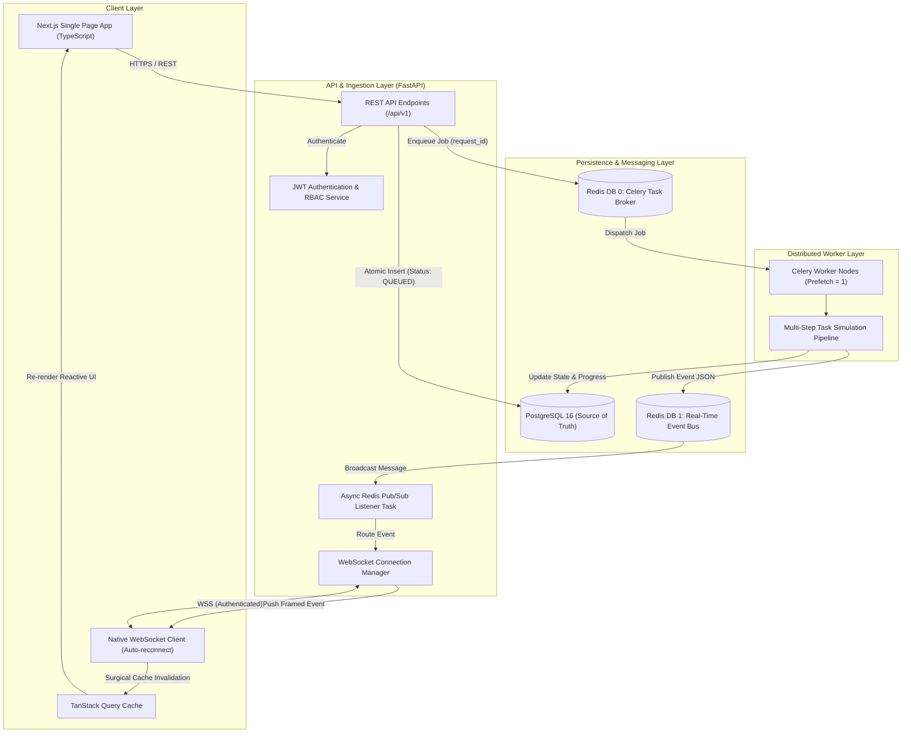
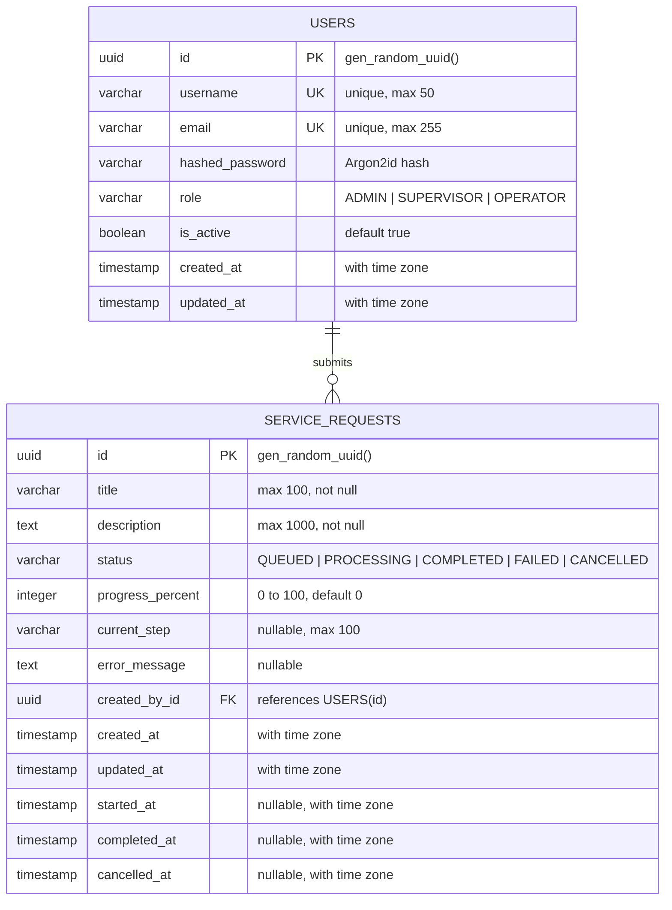

# ServiceFlow: System Architecture & Technical Design

> **Document Version:** 1.0.0  
> **Status:** Approved Baseline  
> **Author:** Lead Engineer  
> **System:** ServiceFlow — Real-Time Service Request Management System  

---

## 1. System Overview & Architectural Topology

ServiceFlow is architectured as a decoupled, event-driven distributed system designed for asynchronous service request processing and sub-second real-time visibility.



---

## 2. Component Boundaries & Responsibilities

| Component | Technology | Primary Responsibilities | Boundaries & Constraints |
| :--- | :--- | :--- | :--- |
| **Frontend** | Next.js (App Router), TypeScript, Tailwind CSS, shadcn/ui | - User authentication and session storage.<br>- Request creation forms with client-side Zod validation.<br>- Paginated, filterable request listings.<br>- Detail view with live animated progress bars.<br>- WebSocket client with exponential backoff reconnection.<br>- TanStack Query cache synchronization. | - Never contains database access.<br>- Never trusts client-side role checks for authorization.<br>- Re-hydrates state from REST on reconnect. |
| **API Server** | FastAPI, Uvicorn, Pydantic v2 | - Validates incoming payloads via Pydantic schemas.<br>- Issues and verifies HMAC-SHA256 JWT tokens.<br>- Enforces RBAC permissions per endpoint.<br>- Persists requests to PostgreSQL transactionally.<br>- Dispatches asynchronous jobs to Redis Celery broker.<br>- Manages active WebSocket client connections.<br>- Runs background listener task consuming Redis Pub/Sub. | - Does not execute long-running compute or sleep operations.<br>- Delegates processing to Celery workers within $< 100\text{ ms}$. |
| **Worker Nodes** | Python, Celery | - Consumes queued jobs from Redis broker.<br>- Executes multi-step processing pipelines.<br>- Commits progress increments and status updates to PostgreSQL.<br>- Publishes event envelopes to Redis Pub/Sub. | - Operates in independent processes from API servers.<br>- Uses dedicated, short-lived database sessions per task. |
| **Database** | PostgreSQL 16 | - Single authoritative source of truth for all entities.<br>- Enforces foreign keys, unique constraints, and check constraints.<br>- B-Tree indexed for rapid query filtering and sorting. | - Schema versioned exclusively via Alembic migrations. |
| **Message Broker** | Redis 7 | - **DB 0:** Celery queue broker for reliable task handoff.<br>- **DB 1:** Pub/Sub channel for worker-to-API event distribution. | - Ephemeral; not treated as persistent entity storage. |

---

## 3. Data Flow & Execution Lifecycles

### 3.1 Service Request Ingestion & Dispatch Flow

1. **Submission:** An operator submits `POST /api/v1/service-requests` with title and description.
2. **Authentication & Validation:** The API validates the JWT token, extracts user identity, and validates payload schema via Pydantic.
3. **Database Commit:** The API creates the entity in PostgreSQL with initial status `QUEUED`, assigning a server-generated UUID and timestamps. The transaction is committed immediately.
4. **Task Dispatch:** Upon successful database commit, the API enqueues a background task via Celery:
   ```python
   process_service_request.delay(request_id=str(request.id))
   ```
5. **Immediate Response:** The API returns `201 Created` with the full request entity in $< 100\text{ ms}$.
6. **Creation Event:** The API publishes a `service_request.created` event to Redis Pub/Sub, alerting connected supervisor and operator clients.

### 3.2 Worker Processing & Progress Lifecycle

```mermaid
<!-- mermaid-checked: every participant uses `participant Id as "Label"`, no \n in aliases/messages/notes, every alt/opt/loop closed by end, no `:` inside any alias -->
sequenceDiagram
    participant Worker as "Celery Worker"
    participant DB as "PostgreSQL"
    participant Redis as "Redis Pub/Sub"
    participant API as "FastAPI WebSocket Manager"
    participant Client as "Frontend Client"

    Worker->>DB: Query Request (Check status)
    alt Status is CANCELLED
        Worker-->>Worker: Abort execution (Idempotent exit)
    else Status is QUEUED
        Worker->>DB: UPDATE status = 'PROCESSING', progress = 0%
        Worker->>Redis: PUBLISH event 'service_request.status_changed'
        Redis-->>API: Broadcast 'service_request.status_changed'
        API-->>Client: Push WS Frame
        
        loop Multi-Step Execution (Steps 1 to 5)
            Worker-->>Worker: Execute Step Workload
            Worker->>DB: UPDATE progress_percent, current_step
            Worker->>Redis: PUBLISH event 'service_request.progress_updated'
            Redis-->>API: Broadcast 'service_request.progress_updated'
            API-->>Client: Push WS Frame (Progress Bar Updates)
        end
        
        Worker->>DB: UPDATE status = 'COMPLETED', progress = 100%, completed_at
        Worker->>Redis: PUBLISH event 'service_request.completed'
        Redis-->>API: Broadcast 'service_request.completed'
        API-->>Client: Push WS Frame (Final State Reached)
    end
```

### 3.3 Atomic Cancellation & Concurrency Guards

To guarantee that requests are cancelled strictly before worker processing starts, the cancellation flow uses conditional SQL execution:

```sql
UPDATE service_requests
SET status = 'CANCELLED',
    cancelled_at = NOW(),
    updated_at = NOW()
WHERE id = :request_id
  AND status = 'QUEUED';
```

- **Row Affected = 1:** The cancellation succeeded. The API commits the transaction, publishes a `service_request.cancelled` event, and returns `200 OK`.
- **Rows Affected = 0:** The request is either already in `PROCESSING`, `COMPLETED`, `FAILED`, or `CANCELLED`. The API rolls back and responds with `409 Conflict` (`Request is not in QUEUED state and cannot be cancelled`).

---

## 4. Concurrency & Task Worker Tuning

To meet the non-functional requirements for concurrent execution and system responsiveness:

1. **Prefetch Multiplier Tuning:**
   * Setting `worker_prefetch_multiplier = 1` prevents a single worker process from hoarding multiple long-running tasks while other workers sit idle.
2. **Late Acknowledgments (`acks_late = True`):**
   * Tasks are only acknowledged to Redis after successful completion. If a worker process abruptly dies or crashes mid-task, the unacknowledged job is immediately redelivered to an active worker.
3. **Database Session Scoping:**
   * Celery workers instantiate a clean, scoped database session per task execution and dispose of connection pool references explicitly upon task exit.
4. **Worker Concurrency:**
   * Configurable concurrency pool (default: 4 concurrent worker threads/processes) configured via `CELERY_WORKER_CONCURRENCY` in environment settings.

---

## 5. Real-Time WebSocket Architecture

### 5.1 Connection Management
The WebSocket endpoint `/api/v1/ws/service-requests` establishes persistent, full-duplex TCP connections:
- **Authentication:** Validates JWT access token transmitted via query parameter `?token=...` during the initial connection handshake.
- **Connection Registry:** `ConnectionManager` maintains active `WebSocket` client references categorized by user ID and role.
- **Role-Aware Filtering:**
  - `Supervisor` and `Admin` connections receive all events published across the system.
  - `Operator` connections receive events specifically targeting their own requests (`created_by_id`).
- **Heartbeat / Keepalive:** Clients transmit lightweight ping frames every 30 seconds; server responds with pong frames to detect and terminate dead/orphaned connections cleanly.

### 5.2 Redis Pub/Sub Distribution
Multiple API instances can run in parallel without loss of WebSocket messages. Background workers publish events to the Redis channel `service_flow:events`. Each FastAPI instance runs an asynchronous listener task on startup that subscribes to this channel and routes incoming messages to locally connected WebSocket clients.

---

## 6. Database Design (Entity-Relationship Model)



### 6.1 Indexing Strategy
- `service_requests.created_at DESC`: Optimizes default pagination and chronological listing.
- `service_requests.status`: Accelerates lifecycle filtering for supervisor queues.
- `service_requests.created_by_id`: Ensures rapid retrieval for operator-scoped queries.
- Composite index `(created_by_id, status)`: Accelerates operator dashboard filters.

---

## 7. Security Architecture

1. **Password Hashing:**
   * Argon2id with recommended OWASP parameters (Time cost $\ge 2$, Memory $\ge 19\text{ MiB}$, Parallelism = 1).
2. **Token Security:**
   * Access tokens: Stateless JWT signed with HMAC-SHA256 using `JWT_SECRET_KEY`.
   * Standard claims: `sub` (user UUID), `role` (user role), `exp` (expiration), `iat` (issued at).
3. **Role-Based Authorization:**
   * Enforced via FastAPI dependencies (`Depends(get_current_active_user)`, `Depends(require_role("SUPERVISOR", "ADMIN"))`).
4. **Input Sanitization & CORS:**
   * Request bodies strictly validated against Pydantic models.
   * CORS middleware configured to whitelist explicit `FRONTEND_ORIGIN` domains.

---

## 8. Deployment Topology (Docker Compose)

The system deploys locally as five coordinated services:

```text
┌────────────────────────────────────────────────────────┐
│                   Docker Network                       │
│                                                        │
│  ┌──────────────┐     ┌──────────────┐                 │
│  │   frontend   │────▶│     api      │                 │
│  │  (Next.js)   │     │  (FastAPI)   │                 │
│  │  Port: 3000  │     │  Port: 8000  │                 │
│  └──────────────┘     └──────┬───────┘                 │
│                              │                         │
│               ┌──────────────┼──────────────┐          │
│               ▼              ▼              ▼          │
│        ┌─────────────┐ ┌───────────┐ ┌─────────────┐   │
│        │  postgres   │ │   redis   │ │   worker    │   │
│        │ (Port 5432) │ │(Port 6379)│ │  (Celery)   │   │
│        └─────────────┘ └───────────┘ └─────────────┘   │
└────────────────────────────────────────────────────────┘
```
