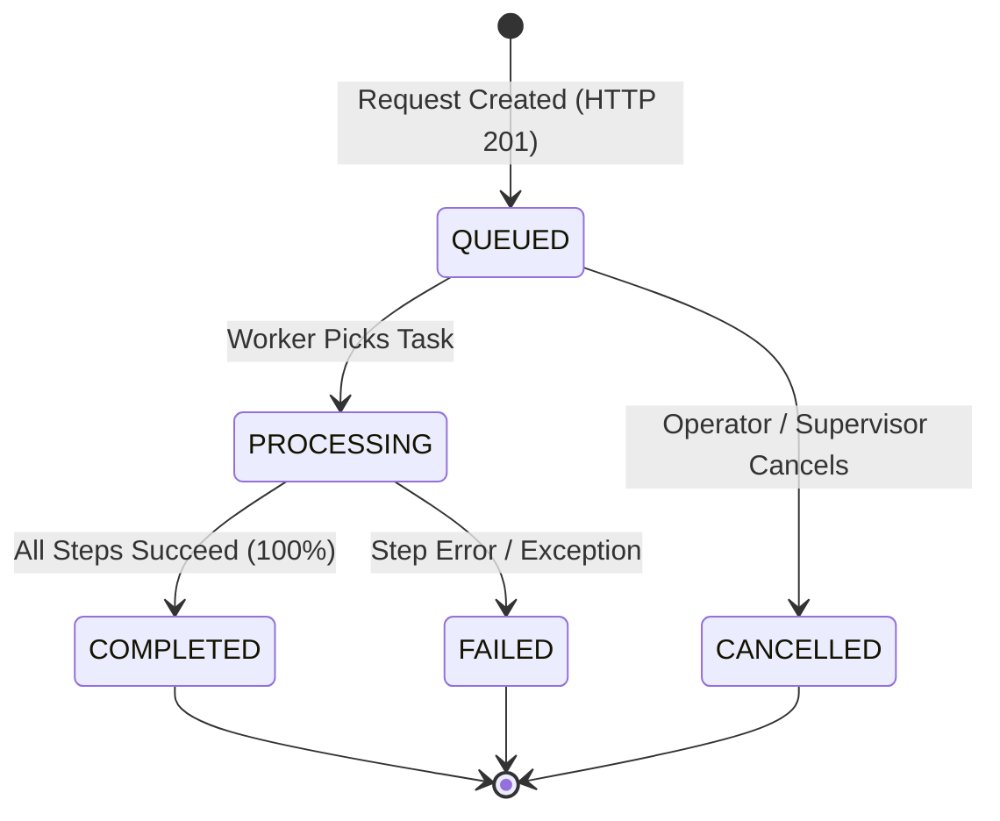

# ServiceFlow: System Requirements & Business Workflow Specification

> **Document Version:** 1.0.0  
> **Status:** Approved Baseline  
> **Author:** Lead Engineer  
> **System:** ServiceFlow — Real-Time Service Request Management System  

---

## 1. Problem Statement & Business Context

Organizations that manage complex customer service requests through manual procedures or traditional ticketing systems experience severe operational inefficiencies:
- **Delayed Visibility:** Supervisors and operators lack immediate visibility into request progress, bottlenecks, or unhandled failures.
- **Synchronous Bottlenecks:** When long-running processing tasks execute synchronously within HTTP request-response cycles, web threads become blocked, causing UI unresponsiveness, request timeouts, and systemic degradation.
- **Client Polling Overhead:** Repetitive HTTP polling for status changes floods databases with redundant read queries while introducing artificial latency between state changes and client updates.

**ServiceFlow** resolves these challenges by decoupling request ingestion from asynchronous background execution, and replacing polling with an event-driven WebSocket communication layer.

---

## 2. Business Objectives

The business objectives of ServiceFlow are:
1. **Accelerate Request Ingestion:** Allow operators to submit service requests rapidly with guaranteed persistence and instantaneous acknowledgment.
2. **Provide Real-Time Operational Visibility:** Stream granular execution milestones (status transitions and progressive percent completion) directly to connected clients without page reloads.
3. **Decouple Heavy Execution:** Process multi-step workloads asynchronously across concurrent background workers without blocking incoming API traffic.
4. **Enforce Role-Based Governance:** Differentiate operational permissions between Operators (self-service submission/tracking) and Supervisors/Admins (global oversight and queue management).
5. **Guarantee System Reliability:** Maintain transactional data integrity in PostgreSQL while utilizing a resilient message broker and pub/sub transport.

---

## 3. Users, Roles & Permission Matrix

ServiceFlow defines three distinct user personas:

| Role | Description | Core Capabilities |
| :--- | :--- | :--- |
| **Operator** | Frontline service personnel submitting and tracking customer issues. | - Create new service requests. - View and search own submitted requests. - Inspect detail view of own requests. - Cancel own requests if still in `QUEUED` status. - Receive live updates for own requests. |
| **Supervisor** | Operations manager responsible for queue throughput and triage. | - View all service requests across the entire organization. - Search and filter across all users and statuses. - Cancel any eligible request in `QUEUED` status. - Monitor global real-time activity and worker progress. |
| **Admin** | System administrator with comprehensive oversight. | - Full supervisor capabilities. - Access to system health, queue diagnostics, and audit capabilities. |

### 3.1 Permission Matrix

| Action / Capability | Operator | Supervisor | Admin |
| :--- | :---: | :---: | :---: |
| Authenticate (Login / Logout) | ✅ | ✅ | ✅ |
| Retrieve Own User Profile | ✅ | ✅ | ✅ |
| Submit Service Request | ✅ | ✅ | ✅ |
| View Own Service Requests | ✅ | ✅ | ✅ |
| View All Service Requests (Global) | ❌ | ✅ | ✅ |
| View Request Details (Own) | ✅ | ✅ | ✅ |
| View Request Details (Any) | ❌ | ✅ | ✅ |
| Cancel Request (Own, if `QUEUED`) | ✅ | ✅ | ✅ |
| Cancel Request (Other User, if `QUEUED`) | ❌ | ✅ | ✅ |
| Connect to WebSocket Stream | ✅ | ✅ | ✅ |
| Receive Targeted Request Updates | ✅ (Own) | ✅ (All) | ✅ (All) |

---

## 4. Service Request Lifecycle & State Transition Model

Every service request strictly adheres to a deterministic, unidirectional finite state machine.

### 4.1 State Definitions
* **`QUEUED`:** Request has been validated, persisted to PostgreSQL, and dispatched to the background message queue. It is awaiting an available worker.
* **`PROCESSING`:** A background worker has claimed the job and is actively executing workload steps. Progress increases from 1% to 99%.
* **`COMPLETED`:** All processing steps completed successfully. Final progress is 100%. Terminal state.
* **`FAILED`:** An unhandled error occurred during step execution. An error message is recorded. Terminal state.
* **`CANCELLED`:** The request was cancelled prior to worker execution. Terminal state.

### 4.2 State Invariants & Transition Rules
1. **Forward-Only Progression:** A terminal state (`COMPLETED`, `FAILED`, `CANCELLED`) can never transition to any other state.
2. **Cancellation Window:** Cancellation is **strictly permitted only when status is `QUEUED`**.
3. **Atomic State Check:** Once a worker sets status to `PROCESSING`, cancellation requests must be rejected with `409 Conflict`.
4. **Worker Idempotency:** If a worker picks a task that was marked `CANCELLED` before the worker started, the worker must immediately abort without processing.

---

## 5. Functional Requirements

### Domain 1: Authentication & Identity Management

#### REQ-001: User Authentication
* **Description:** The system must authenticate users via username/password and issue secure, stateless JWT tokens.
* **User Scenario:**
  * **Given** a registered user with valid credentials,
  * **When** they submit a login request,
  * **Then** the system returns an access token, token expiration, and user profile with role.
  * **Given** invalid credentials,
  * **When** a login request is submitted,
  * **Then** the system returns a `401 Unauthorized` with a generic failure message.

#### REQ-002: Identity Context & Role Inspection
* **Description:** The system must provide an endpoint to resolve the authenticated user's profile and permissions.
* **Acceptance Criteria:**
  * Endpoint `GET /api/v1/auth/me` validates the bearer token.
  * Returns user ID, username, email, role, and active status.
  * Rejects expired, malformed, or missing tokens with `401 Unauthorized`.

---

### Domain 2: Service Request Submission & Management

#### REQ-003: Service Request Submission
* **Description:** Operators and supervisors must be able to submit new service requests.
* **User Scenario:**
  * **Given** an authenticated user,
  * **When** they submit a valid request with `title` (3–100 chars) and `description` (10–1000 chars),
  * **Then** the system creates a record in `QUEUED` state, assigns a UUID, commits to the database, dispatches a background task, and returns `201 Created` with full entity details.
  * **When** required fields are missing or invalid,
  * **Then** the system returns `422 Unprocessable Entity` with field-level validation errors.

#### REQ-004: Service Request Listing & Role Scoping
* **Description:** Users must be able to list requests scoped to their permissions.
* **User Scenario:**
  * **Given** an authenticated **Operator**,
  * **When** they query the request list,
  * **Then** they only receive requests where `created_by_id == current_user.id`.
  * **Given** an authenticated **Supervisor** or **Admin**,
  * **When** they query the request list,
  * **Then** they receive all requests across the organization.
  * Results must support pagination (`limit`, `offset`) and sorting by `created_at` descending by default.

#### REQ-005: Service Request Details
* **Description:** Authorized users must be able to inspect full details of a specific request.
* **Acceptance Criteria:**
  * Endpoint `GET /api/v1/service-requests/{id}` returns the complete entity: status, progress, current step, error message, timestamps (`created_at`, `started_at`, `completed_at`, `cancelled_at`).
  * Operators querying a request owned by another user receive `403 Forbidden`.
  * Non-existent IDs return `404 Not Found`.

#### REQ-006: Search & Status Filtering
* **Description:** The listing endpoint must support searching by text and filtering by status.
* **Acceptance Criteria:**
  * Query parameter `status` filters by exact lifecycle state (`QUEUED`, `PROCESSING`, `COMPLETED`, `FAILED`, `CANCELLED`).
  * Query parameter `search` performs a case-insensitive search matching against `title` and `description`.
  * Filters can be combined seamlessly with pagination parameters.

#### REQ-007: Atomic Request Cancellation
* **Description:** Operators and supervisors must be able to cancel requests that have not yet started processing.
* **User Scenario:**
  * **Given** an eligible request with status `QUEUED`,
  * **When** the creator or a supervisor submits `POST /api/v1/service-requests/{id}/cancel`,
  * **Then** the status transitions atomically to `CANCELLED`, `cancelled_at` is recorded, and a cancellation event is published.
  * **Given** a request currently in `PROCESSING`, `COMPLETED`, or `FAILED`,
  * **When** a cancellation request is submitted,
  * **Then** the system rejects the operation with `409 Conflict` and message stating the request cannot be cancelled.

---

### Domain 3: Concurrency & Background Execution

#### REQ-008: Non-Blocking Background Execution
* **Description:** Long-running processing workloads must execute in background workers without blocking the API event loop.
* **Acceptance Criteria:**
  * The HTTP `POST` submission endpoint returns `201 Created` in $< 100\text{ ms}$.
  * Execution is delegated to a distributed worker via message queue.
  * Multiple requests submitted simultaneously execute concurrently up to worker concurrency limits.

#### REQ-009: Multi-Step Processing & Progress Simulation
* **Description:** The background worker must simulate a realistic multi-step processing pipeline.
* **Acceptance Criteria:**
  * Processing advances through distinct, sequential steps (e.g., Step 1: Validation, Step 2: Data Extraction, Step 3: Transformation, Step 4: Verification, Step 5: Finalization).
  * Each step updates `progress_percent` (e.g., 20%, 40%, 60%, 80%, 100%) and `current_step` in PostgreSQL.
  * Each progress increment triggers a real-time event.

#### REQ-010: Error Handling & Failure Reporting
* **Description:** If a worker encounters an error or simulated failure condition, the task must safely handle the exception.
* **Acceptance Criteria:**
  * Status transitions to `FAILED`.
  * A sanitized error explanation is saved in `error_message`.
  * A `service_request.failed` event is broadcast via WebSockets.
  * The worker thread remains healthy and continues processing subsequent queue jobs.

---

### Domain 4: Real-Time Communication & Synchronization

#### REQ-011: Native WebSocket Streaming
* **Description:** The system must push live updates to connected frontend clients over a persistent WebSocket connection.
* **Acceptance Criteria:**
  * Endpoint `/api/v1/ws/service-requests` authenticates clients via token.
  * Events are distributed from background workers to API servers via Redis Pub/Sub.
  * Clients receive updates for created, status-changed, progress-updated, completed, failed, and cancelled requests in real-time.
  * No client polling is used for primary status synchronization.

#### REQ-012: Connection Resiliency & State Hydration
* **Description:** The client must seamlessly recover from disconnects or page refreshes.
* **Acceptance Criteria:**
  * On initial load or reconnection, the frontend fetches the current authoritative state from REST API (`GET /api/v1/service-requests`).
  * If the WebSocket disconnects, the client initiates automatic reconnection with exponential backoff.
  * Reconnected sessions immediately resume receiving live events without duplicating entries.

---

## 6. Non-Functional Requirements (NFR)

### NFR-001: Performance & Latency
* **API Response Time:** 95% of standard REST API requests (`GET`, `POST`, `PATCH`) must respond within $\le 100\text{ ms}$ under normal demonstration load.
* **Event Propagation Latency:** The delay between a worker updating progress in PostgreSQL/Redis and the WebSocket event arriving at the browser client must be $\le 250\text{ ms}$.

### NFR-002: Concurrency & Throughput
* **Simultaneous Operations:** The background worker pool must process at least 4 concurrent requests in parallel without queue starvation or database lock contention.
* **API Non-blocking:** Sustained background processing must cause zero degradation to API responsiveness.

### NFR-003: Reliability & Data Integrity
* **ACID Compliance:** All state transitions and request data must be committed transactionally in PostgreSQL.
* **Isolation:** Worker tasks must operate in separate database sessions to prevent session cross-talk or uncommitted dirty reads.
* **Worker Crash Durability:** In-flight tasks in Redis must be acknowledged only upon completion (`acks_late = True`), ensuring tasks are requeued if a worker process dies unexpectedly.

### NFR-004: Security & Access Control
* **Authentication:** Passwords must be hashed using the memory-hard **Argon2id** algorithm.
* **Transport Security:** All API and WebSocket interactions must validate JWT credentials and enforce CORS policies restricted to configured frontend origins.
* **Data Sanitization:** Error messages returned to clients or broadcast via WebSockets must never expose stack traces, database credentials, or internal server paths.

### NFR-005: Maintainability & Code Quality
* **Architecture:** Strict layered architecture separating Endpoints, Schemas, Services, Repositories, Models, and Workers.
* **Schema Migrations:** All database alterations must be managed via version-controlled Alembic migrations.
* **Type Safety:** 100% type-annotated Python backend (mypy/Pydantic) and TypeScript frontend.

### NFR-006: High Availability & Fault Tolerance
* **Graceful Degradation:** If the WebSocket connection fails or drops, the frontend remains fully functional through REST API data fetching.
* **Health Probes:** The API must expose `/health` (liveness) and `/ready` (database + Redis connectivity) endpoints for monitoring and container orchestration.

### NFR-007: Usability & User Experience
* **Responsive Layout:** The web interface must be fully usable across modern desktop, tablet, and mobile viewport widths.
* **Feedback & States:** Clear loading skeletons, error banners, empty state indicators, and animated progress bars for active requests.

---

## 7. Assumptions & System Boundaries

### 7.1 Key Assumptions
1. **Simulated Workload:** In the absence of an external third-party proprietary API, the background task executes a simulated multi-step business process with controlled delays to demonstrate real-time progress and concurrent worker capacity.
2. **PostgreSQL as Primary Truth:** PostgreSQL is the single source of truth for all persistent entities. Redis acts strictly as a transient task broker and ephemeral pub/sub event bus.
3. **Seed Accounts:** For standard evaluation and demonstration, seed users are provisioned for `admin`, `supervisor`, and `operator` roles.
4. **WebSocket Event Scoping:** Operators receive real-time events relevant to their own requests; supervisors and admins receive events for all requests across the system.

### 7.2 Explicit Scope Exclusions
The following capabilities are deliberately out of scope for the current system architecture:
- Public user self-registration (user provisioning is handled via administrative seeding).
- Multi-tenant organizational data segregation.
- Third-party OAuth/SAML single sign-on.
- File attachment processing or object storage (S3/Blob).
- External SMS/email alerting channels.
- Cloud-specific managed infrastructure dependencies.

---

## 8. Requirements Traceability Matrix

| Requirement ID | Domain | User Role | Testable Criterion | Target Phase |
| :--- | :--- | :--- | :--- | :--- |
| **REQ-001** | Identity | All | JWT login with valid credentials; 401 on failure | Phase 8 |
| **REQ-002** | Identity | All | `GET /auth/me` resolves profile & role | Phase 8 |
| **REQ-003** | Request Mgmt | Operator, Supervisor | `POST /service-requests` returns 201 with UUID | Phase 9 |
| **REQ-004** | Request Mgmt | Operator, Supervisor | Listing scoped by user role + pagination | Phase 9 |
| **REQ-005** | Request Mgmt | Operator, Supervisor | `GET /service-requests/{id}` enforces ownership | Phase 9 |
| **REQ-006** | Request Mgmt | Operator, Supervisor | Search by text + filter by status | Phase 9 |
| **REQ-007** | Request Mgmt | Operator, Supervisor | Cancel allowed only in `QUEUED`; 409 if processing | Phase 9 |
| **REQ-008** | Concurrency | System | Ingestion completes $< 100\text{ ms}$; task dispatched | Phase 10 |
| **REQ-009** | Concurrency | System | Multi-step progress increments (0% $\to$ 100%) | Phase 10 |
| **REQ-010** | Concurrency | System | Controlled failure transitions state to `FAILED` | Phase 10 |
| **REQ-011** | Real-Time | All | WebSocket pushes events via Redis Pub/Sub | Phase 11 |
| **REQ-012** | Real-Time | Client | Auto-reconnect & REST state rehydration | Phase 15 |
