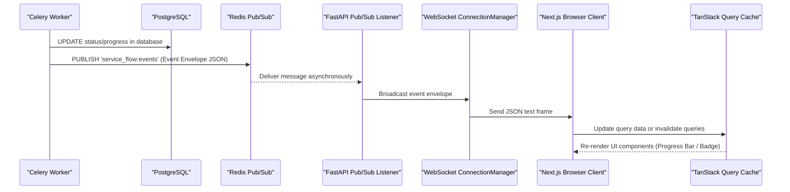

# ServiceFlow: WebSocket Event Specification & Protocol

> **Document Version:** 1.0.0  
> **Status:** Approved Baseline  
> **Author:** Lead Engineer  
> **System:** ServiceFlow — Real-Time Service Request Management System  

---

## 1. WebSocket Protocol & Handshake

ServiceFlow uses native, full-duplex WebSockets to stream real-time lifecycle updates from the server to connected frontend clients without client-side polling.

* **Endpoint:** `/api/v1/ws/service-requests`
* **Transport:** `ws://` (Local development) / `wss://` (Production)
* **Subprotocol:** None (Pure JSON text frames)

### 1.1 Connection Authentication Handshake
Clients authenticate during the WebSocket upgrade handshake by supplying their JWT access token as a query parameter:

```http
GET /api/v1/ws/service-requests?token=eyJhbGciOiJIUzI1NiIsInR5cCI6IkpXVCJ9... HTTP/1.1
Host: localhost:8000
Upgrade: websocket
Connection: Upgrade
Sec-WebSocket-Key: dGhlIHNhbXBsZSBub25jZQ==
Sec-WebSocket-Version: 13
Origin: http://localhost:3000
```

#### Handshake Validation Rules:
1. **Origin Verification:** Server validates `Origin` against authorized `FRONTEND_ORIGIN` whitelist.
2. **Token Verification:** Server validates signature and expiration of the JWT token.
3. **Connection Acceptance:** If valid, the connection upgrades with HTTP `101 Switching Protocols`.
4. **Rejection:** If invalid, the connection is closed immediately with WebSocket status code `1008 Policy Violation` (`4001: Invalid or expired credentials`).

---

## 2. Standard Event Envelope

All server-pushed real-time messages are serialized in a standardized event envelope format:

```json
{
  "event_id": "9b1deb4d-3b7d-4bad-9bdd-2b0d7b3dcb6d",
  "event_type": "service_request.progress_updated",
  "occurred_at": "2026-11-20T19:55:00.123456Z",
  "request_id": "7c9e6679-7425-40de-944b-e07fc1f90ae7",
  "data": {
    "status": "PROCESSING",
    "progress_percent": 60,
    "current_step": "Step 3: Transformation",
    "error_message": null
  }
}
```

### 2.1 Envelope Fields

| Field | Type | Description |
| :--- | :--- | :--- |
| `event_id` | UUID (string) | Unique identifier for the specific event instance. |
| `event_type` | string | Dot-delimited event name (e.g. `service_request.completed`). |
| `occurred_at` | string (ISO 8601 UTC) | Timestamp when the event was generated. |
| `request_id` | UUID (string) | ID of the affected service request entity. |
| `data` | object | Event-specific payload containing updated entity attributes. |

---

## 3. Event Catalog

### 3.1 `service_request.created`
* **Trigger:** A new service request has been committed to PostgreSQL and dispatched to Celery.
* **Recipients:** Supervisors/Admins (all), Operator (if creator).
* **Payload:**
```json
{
  "event_id": "1a2b3c4d-0001-4000-8000-000000000001",
  "event_type": "service_request.created",
  "occurred_at": "2026-11-20T19:54:10Z",
  "request_id": "7c9e6679-7425-40de-944b-e07fc1f90ae7",
  "data": {
    "title": "Customer Data Sync Pipeline",
    "status": "QUEUED",
    "progress_percent": 0,
    "current_step": null,
    "created_by_id": "3fa85f64-5717-4562-b3fc-2c963f66afa6",
    "created_at": "2026-11-20T19:54:10Z"
  }
}
```

---

### 3.2 `service_request.status_changed`
* **Trigger:** The request transitioned between major lifecycle states (e.g. `QUEUED` $\to$ `PROCESSING`).
* **Recipients:** Supervisors/Admins (all), Operator (if creator).
* **Payload:**
```json
{
  "event_id": "1a2b3c4d-0002-4000-8000-000000000002",
  "event_type": "service_request.status_changed",
  "occurred_at": "2026-11-20T19:54:12Z",
  "request_id": "7c9e6679-7425-40de-944b-e07fc1f90ae7",
  "data": {
    "status": "PROCESSING",
    "progress_percent": 0,
    "current_step": "Step 1: Validation",
    "started_at": "2026-11-20T19:54:12Z"
  }
}
```

---

### 3.3 `service_request.progress_updated`
* **Trigger:** A background worker completed a progress milestone within the task pipeline.
* **Recipients:** Supervisors/Admins (all), Operator (if creator).
* **Payload:**
```json
{
  "event_id": "1a2b3c4d-0003-4000-8000-000000000003",
  "event_type": "service_request.progress_updated",
  "occurred_at": "2026-11-20T19:54:16Z",
  "request_id": "7c9e6679-7425-40de-944b-e07fc1f90ae7",
  "data": {
    "status": "PROCESSING",
    "progress_percent": 40,
    "current_step": "Step 2: Data Extraction"
  }
}
```

---

### 3.4 `service_request.completed`
* **Trigger:** The worker successfully concluded all pipeline steps.
* **Recipients:** Supervisors/Admins (all), Operator (if creator).
* **Payload:**
```json
{
  "event_id": "1a2b3c4d-0004-4000-8000-000000000004",
  "event_type": "service_request.completed",
  "occurred_at": "2026-11-20T19:54:30Z",
  "request_id": "7c9e6679-7425-40de-944b-e07fc1f90ae7",
  "data": {
    "status": "COMPLETED",
    "progress_percent": 100,
    "current_step": "Step 5: Finalization",
    "completed_at": "2026-11-20T19:54:30Z"
  }
}
```

---

### 3.5 `service_request.failed`
* **Trigger:** A step raised an unhandled exception or an explicit error was caught during processing.
* **Recipients:** Supervisors/Admins (all), Operator (if creator).
* **Payload:**
```json
{
  "event_id": "1a2b3c4d-0005-4000-8000-000000000005",
  "event_type": "service_request.failed",
  "occurred_at": "2026-11-20T19:54:22Z",
  "request_id": "7c9e6679-7425-40de-944b-e07fc1f90ae7",
  "data": {
    "status": "FAILED",
    "progress_percent": 40,
    "current_step": "Step 2: Data Extraction",
    "error_message": "Secondary data source connection timed out"
  }
}
```

---

### 3.6 `service_request.cancelled`
* **Trigger:** The request was cancelled by the creator or supervisor while in `QUEUED` state.
* **Recipients:** Supervisors/Admins (all), Operator (if creator).
* **Payload:**
```json
{
  "event_id": "1a2b3c4d-0006-4000-8000-000000000006",
  "event_type": "service_request.cancelled",
  "occurred_at": "2026-11-20T19:54:15Z",
  "request_id": "7c9e6679-7425-40de-944b-e07fc1f90ae7",
  "data": {
    "status": "CANCELLED",
    "progress_percent": 0,
    "cancelled_at": "2026-11-20T19:54:15Z"
  }
}
```

---

## 4. End-to-End Real-Time Event Sequence

<!-- mermaid-checked: every participant uses `participant Id as "Label"`, no \n in aliases/messages/notes, every alt/opt/loop closed by end, no `:` inside any alias -->


---

## 5. Heartbeat & Connection Resiliency

### 5.1 Keep-Alive / Heartbeat Protocol
* The client sends a lightweight text frame `{"type": "ping"}` every 30 seconds.
* The FastAPI server responds with `{"type": "pong"}`.
* If the server does not receive a ping frame within 60 seconds, the connection is terminated and purged from the active registry to prevent resource leaks.

### 5.2 Client-Side Auto-Reconnection & State Rehydration
Network interruptions or browser tab sleep states are handled through a deterministic reconnection cycle:

```text
Connection Lost ──▶ Exponential Backoff (1s, 2s, 4s, 8s, max 30s) ──▶ Reconnect Handshake
                                                                            │
                                                                            ▼
                                                                     On Open Callback
                                                                            │
                                                                            ▼
                                                                 REST State Rehydration
                                                       (GET /api/v1/service-requests)
```

1. **Exponential Backoff:** The client attempts to reconnect after 1s, doubling the interval on repeated failures up to a 30s ceiling.
2. **State Rehydration:** When the WebSocket connection re-establishes, the client executes a background `GET /api/v1/service-requests` query to sync any state changes that occurred during the disconnected window.
3. **Resumed Event Stream:** Subsequent live events apply smoothly on top of the refreshed baseline.
