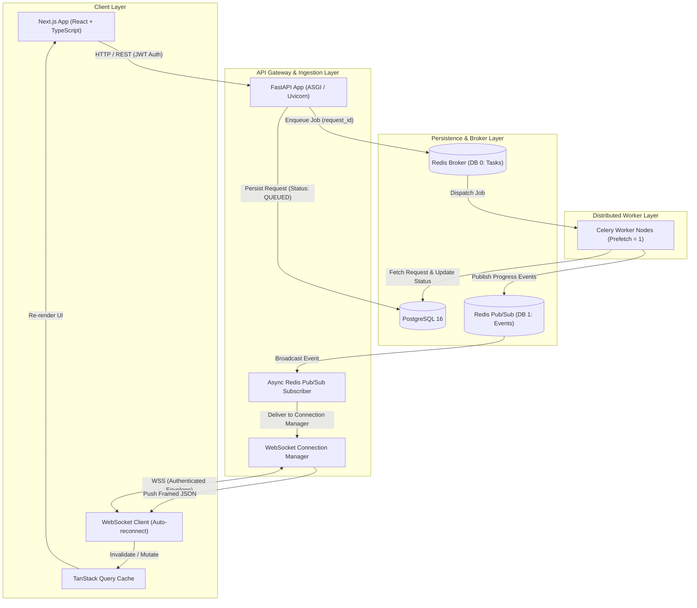

# Engineering Journal & Technical Deep-Dive: ServiceFlow

> **Author:** Lead Engineer  
> **Project:** ServiceFlow — Real-Time Service Request Management System  
> **Purpose:** This document serves as my architectural blueprint, design rationale, implementation journal, and technical interview defense guide.

---

## 1. Executive Summary & Problem Space

I am building **ServiceFlow**, a production-grade, distributed web platform designed to eliminate delays and opacity in manual service request handling. 

### The Core Problem
In traditional service setups, operators submit customer requests via manual forms or legacy ticketing tools. Supervisors lack real-time visibility into operational bottlenecks, request progression, or worker failures. When batch operations execute synchronously, HTTP request threads block, causing UI freezing, request timeouts, and cascading downtime.

### My Architectural Solution
I designed ServiceFlow with a decoupled, asynchronous, event-driven architecture:
1. **Non-blocking API Ingestion:** An asynchronous HTTP REST layer accepts incoming service requests in sub-millisecond time, persists them in `QUEUED` state, and immediately hands off workload execution to an independent task queue.
2. **Distributed Concurrency:** Background workers (Celery) pull tasks from a message broker (Redis) and execute multi-step business routines concurrently without locking the web server event loop.
3. **Push-Based Live Visibility:** Progress steps and lifecycle transitions publish lightweight event envelopes to Redis Pub/Sub, which broadcast across active WebSocket server connections directly to the Next.js frontend without client polling.

---

## 2. Technology Stack & Architectural Justifications (Interview Defense)

When asked in an interview why I selected this specific stack over alternatives, here is my technical defense:

### 2.1 Backend: Python (FastAPI) vs. Node.js (Express/Nest) vs. Go (Gin)
* **Choice:** Python 3.11+ with **FastAPI** (Uvicorn / Starlette).
* **Rationale:**
  * **Native Asynchronous I/O:** FastAPI is built on ASGI (`async`/`await`), offering exceptional throughput for I/O-bound operations (database queries, WebSocket connection management, Redis Pub/Sub listener loops).
  * **Strict Data Validation & Typing:** Pydantic v2 (compiled with Rust) enforces runtime data validation, automatic serialization, and OpenAPI contract generation out of the box.
  * **Ecosystem for Complex Workflows:** Python offers the maturest ecosystem for asynchronous distributed task orchestration (Celery) and scalable background computing.

### 2.2 Concurrency & Worker Engine: Celery + Redis vs. In-Process Threading
* **Choice:** **Celery** backed by **Redis** as a distributed broker.
* **Why not Python `threading` or `asyncio.create_task`?**
  * In-process background tasks tie background execution to the web process lifecycle. If the web server crashes or restarts, all in-flight jobs are dropped and lost.
  * Python’s GIL (Global Interpreter Lock) restricts true CPU-bound multi-threading.
  * Celery gives me horizontal worker scalability: I can scale API servers independently from background compute workers based on traffic characteristics.

### 2.3 Real-Time Transport: Native WebSockets vs. Server-Sent Events (SSE) vs. Polling
* **Choice:** **Native WebSockets** with Redis Pub/Sub distribution.
* **Why not Short/Long Polling?**
  * Polling creates unnecessary HTTP handshake overhead, floods the database with redundant `SELECT` queries, and introduces artificial latency ($N$ second interval).
* **Why WebSockets over SSE?**
  * Although SSE is unidirectional (server-to-client), WebSockets provide a full-duplex persistent TCP connection with minimal frame header overhead (2–10 bytes vs. hundreds of bytes in HTTP headers per SSE frame). It establishes a standard infrastructure foundation for future bi-directional interactions (e.g., real-time supervisor comments, operator acknowledgments).

### 2.4 Database & ORM: PostgreSQL + SQLAlchemy 2.0 (Async) vs. MongoDB
* **Choice:** **PostgreSQL** with **SQLAlchemy 2.0 Async Engine** and **Alembic**.
* **Rationale:**
  * Service requests require strict relational integrity, ACID compliance, and robust lifecycle state invariants (`QUEUED` $\to$ `PROCESSING` $\to$ `COMPLETED` / `FAILED` / `CANCELLED`).
  * Explicit schema migrations with Alembic ensure controlled, zero-downtime deployment capabilities.
  * Relational indexing (B-Tree on `status`, `created_by_id`, `created_at`) optimizes high-volume dashboard filtering.

### 2.5 Frontend: Next.js (App Router) + TypeScript + TanStack Query + Tailwind CSS
* **Choice:** **Next.js App Router (React 19)**, **TypeScript**, **shadcn/ui**, **TanStack Query (React Query)**.
* **Rationale:**
  * **TanStack Query:** Provides optimal client-side server state management. When WebSocket messages arrive, I directly patch or invalidate targeted query cache keys, preventing full-page re-fetching and eliminating UI layout thrashing.
  * **TypeScript + Zod:** Guarantees strict type safety end-to-end matching backend Pydantic schemas.

---

## 3. System Architecture & Component Design



---

## 4. Concurrency Model & Lifecycle State Invariants

### 4.1 State Machine Design
I established a unidirectional, deterministic lifecycle for all service requests:

```text
       [CREATE]
          │
          ▼
       QUEUED ───────────────┐
          │                  │
          │ (Worker Pick)    │ (Cancel Action)
          ▼                  ▼
      PROCESSING         CANCELLED
       │      │
       │      │ (Error / Exception)
       │      ▼
       │    FAILED
       ▼
   COMPLETED
```

### 4.2 Handling Race Conditions & State Invariants
1. **Cancellation Boundary:**
   * A request is **cancellable only while in `QUEUED` status**.
   * If an operator triggers `POST /api/v1/service-requests/{id}/cancel` while a worker is concurrently transitioning it to `PROCESSING`, I use an atomic database transaction with `SELECT ... FOR UPDATE` or conditional update:
     $$\text{UPDATE service\_requests SET status = 'CANCELLED' WHERE id = :id AND status = 'QUEUED'}$$
   * If zero rows are affected, the API responds with `409 Conflict`, informing the user that processing has already commenced.
2. **Worker Idempotency:**
   * Workers verify current status before updating. If a job is picked up by a worker but its database status is already `CANCELLED`, the worker safely aborts execution immediately.

---

## 5. Security & Access Control Model

1. **Authentication:**
   * Stateless JSON Web Tokens (JWT) signed with HMAC-SHA256 (`HS256`).
   * Password hashing using **Argon2id** (memory-hard, resistant to GPU/ASIC brute-force attacks).
2. **Role-Based Access Control (RBAC):**
   * **Operator:** Can create requests, query their own requests, and cancel their own `QUEUED` requests.
   * **Supervisor:** Can view all requests across the organization, monitor live metrics, and cancel any `QUEUED` request.
   * **Admin:** Full supervisor capabilities plus administrative system configuration.
   * *Rule:* Frontend UI rendering respects roles, but backend API dependencies (`get_current_active_user`, `require_role(...)`) strictly enforce authorization at the endpoint layer.

---

## 6. Implementation Progress & Engineering Log

### Phase 1: Project Initialization & Repository Setup
- [x] Initialized Git repository on `main` branch.
- [x] Added `.gitignore` configured for Python, Node.js, Docker, and environment files.
- [x] Excluded raw specification files (`Project.md`, `Project_implementation_plan.md`) from Git tracking.
- [x] Created `README.md` and initialized this `engineering.md` technical journal.
- [x] Configured GitHub remote origin: `https://github.com/midu-01/ServiceFlow.git`.

*(Subsequent phases will be logged here incrementally as implementation proceeds.)*
